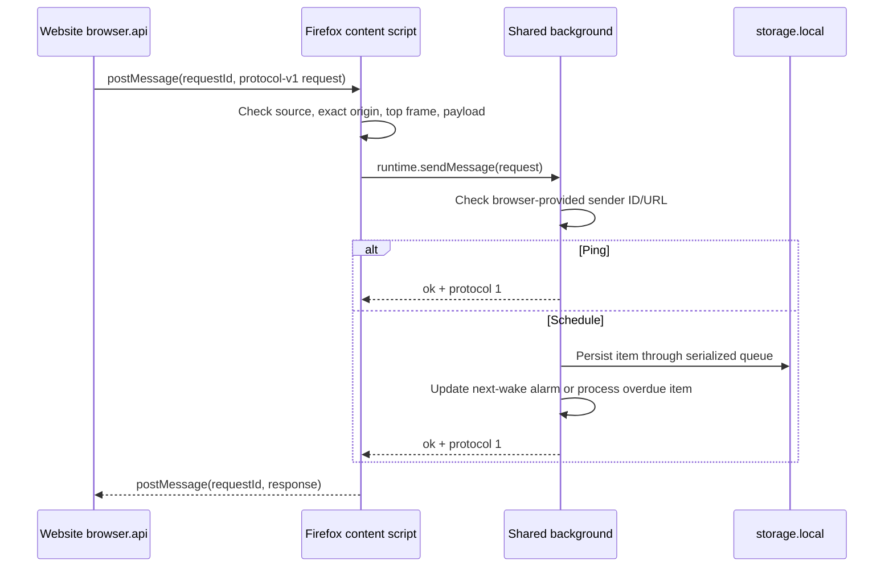
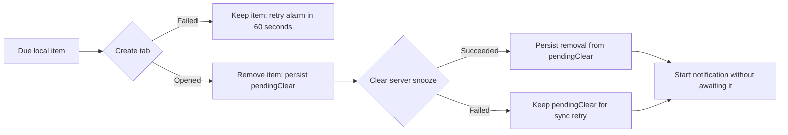

# Chrome and Firefox extension architecture

One React popup, GraphQL client, and snooze scheduler serve both MV3 extensions.
Firefox targets desktop 140+ (ESR/Nightly included); Android and container-specific
accounts are outside scope. Shared metadata/version: `apps/web/src/manifest.json`.

## Build pipeline

[`vite.config.ts`](../apps/web/vite.config.ts) reads
`SHLK_EXTENSION_BROWSER=chrome|firefox` (default `chrome`). Existing Vite modes
`extension` and `extension-development` still control environment loading.
Each build empties only its own output directory.

```text
React popup + background.ts + common manifest
                    |
              Vite browser target
              /                  \
     Chrome overrides       Firefox overrides
     dist/extension         dist/extension-firefox
                                  + website-content-script.js
```

Paths above are relative to `apps/web`. The website uses `dist/web`.
Popup/background entries share ES module chunks. Firefox's content script uses
a separate Vite IIFE build; generation rejects imports or multiple chunks so it
can run as a standalone classic script at `document_start`.

| Manifest setting | Chrome | Firefox |
| --- | --- | --- |
| Background | Module service worker | Nonpersistent module `background.scripts` |
| Website transport | `externally_connectable` | Top-frame content script |
| Identity | ID from `EXTENSION_ORIGIN` | `gecko.id: shlk@shlk.cc` |
| Minimum version | Existing Chrome behavior | `strict_min_version: 140.0` |
| Host patterns | Configured backend origin | Backend hostname; omit port |
| Popup shortcut | Ctrl+Shift+S; Command+Shift+S on macOS | Alt+Shift+S |

Firefox declares required data categories: `personallyIdentifyingInfo`,
`authenticationInfo`, `browsingActivity`, `websiteContent`. These cover the
existing account/session, submitted URL, and content flows.

```sh
# Repository root; existing build:extension/dev:extension aliases select Chrome.
bun run build:extension:chrome
bun run build:extension:firefox
bun run build:extensions          # Both extensions
bun run build                    # Website + both extensions + API typecheck
bun run dev:extension:firefox     # API + Firefox build watcher
```

Docker exports `shlk-extension.zip` through `extension-artifact`, and
`shlk-extension-firefox.zip` through `firefox-extension-artifact`. Both ZIPs put
`manifest.json` at their root. Firefox's standalone Docker build requires no
Chrome ID/store URL. See [release commands](../docs/firefox-extension-release.md).

## Native API boundary

[`extension.api.ts`](../apps/web/src/js/extension.api.ts) selects
`globalThis.browser ?? globalThis.chrome` and defines the narrow shared API types.
[`browser.api.ts`](../apps/web/src/js/browser.api.ts) wraps tabs, alarms, runtime
messages, and notifications; `proxy-storage.extension.ts` uses the same resolver
for `local`, `sync`, and `session` storage. Missing storage rejects explicitly;
native storage failures propagate.

Shared extension APIs use promises. Chrome website-to-extension messaging keeps
its callback API and checks `runtime.lastError`. Firefox is identified from
`runtime.getURL('')` using the `moz-extension:` scheme; notification `priority`
is removed only for Firefox.

## Website messaging

`probeSnoozeExtension()` tries a protocol-v1 Chrome ping, then the Firefox bridge.
Concurrent probes share one promise. The selected transport is retained for
scheduling. Each schedule is sent once; timeout does not trigger a second
transport attempt because the first request may already have been accepted.



[`website-bridge.ts`](../apps/web/src/js/website-bridge.ts) correlates replies by
UUID request ID. Client waits remove their message listener/timer on completion
or timeout. Each page/runtime messaging wait is bounded at 2,000 ms; timeout does
not cancel background work. The content script suppresses duplicate in-flight
IDs and removes listeners on nonpersisted `pagehide`.

Example page-to-content-script envelope; responses use `direction: "response"`
with the same ID and `response: { ok: true, protocol: 1 }`:

```json
{
  "channel": "shlk:website-bridge:v1",
  "direction": "request",
  "requestId": "3e3e151b-7963-4949-a6ce-3346c073d681",
  "message": {
    "type": "shlk:schedule",
    "protocol": 1,
    "item": { "id": "link-42", "location": "https://example.com/", "awake": 1800000000000 }
  }
}
```

Trust checks:

- Content-script injection matches the configured website; runtime checks require
  `window.top === window`, `event.source === window`, and the exact origin/port.
  Example: `WEB_APP_URL=http://localhost:5173` emits `http://localhost/*`, but a
  page on `localhost:5174` cannot use the bridge.
- Protocol validation permits only v1 ping/schedule, a nonblank ID, HTTP(S) URL,
  positive finite wake timestamp, and optional string title.
- Internal background messages require this extension's `sender.id` and either
  its own extension URL or a top-frame tab URL matching the configured website.
  Sender identity comes from browser metadata. Chrome external messages check
  browser-provided `sender.origin` against that website origin.

## Scheduler persistence and recovery

[`background.ts`](../apps/web/src/js/background.ts) registers listeners before
async work. `initializeBackground()` memoizes initialization per context; install,
startup, and context recreation share that path. Initialization migrates legacy
`storage.sync` keys named `link_*`, ensures the sync alarm, restores local alarms
or overdue tabs, then reconciles with server data. `BackgroundApp.run()` serializes
schedule, alarm, and initialization operations through one promise queue.

Persisted `storage.local["shlk:snooze-state"]` has this shape:

```json
{
  "items": {
    "link-42": { "id": "link-42", "location": "https://example.com/", "awake": 1800000000000 }
  },
  "pendingClear": { "already-restored-link": true }
}
```



`shlk:next-wake` targets the earliest item; no items removes that alarm.
`shlk:sync` starts after one minute and repeats every ten minutes. Reconciliation
flushes pending clears, fetches paginated server snoozes, excludes IDs still in
`pendingClear`, then rebuilds the next alarm. This avoids reopening restored tabs
after server cleanup failure. Notification failure cannot block server cleanup
or the operation queue. Tab creation and storage writes are separate operations;
there is no atomic exactly-once guarantee across a crash between them.

## Authentication, UI, and startup invariants

Extension popup/background fetches retain `credentials: 'include'` and use backend
host permissions. The Firefox installation's random URL UUID differs from its
stable add-on ID; neither belongs in the API's Chrome CORS setting. Session-cookie
policy is unchanged. Sign in through a normal tab: container cookies are separate.
Browser storage is independent across browsers; authenticated history uses the API.

Status text is browser-neutral. Chrome links use `VITE_EXTENSION_STORE_URL`;
Firefox links use `VITE_FIREFOX_EXTENSION_STORE_URL` and disappear when unset.

Keep [startup ordering](./web-loading-process.md):

```text
Extension: active tab -> authentication -> initial cache -> mount React
Website:   mount React -> resolve authentication/cache asynchronously
```

The popup snapshots its initial tab URL. Mounting it before initialization would
break prefill. Shared React state and GraphQL interfaces remain unchanged.

## Verification references

Regression tests: `extension-api`, `website-bridge`, `browser-api`, `background`,
`background-startup`, `build-config`, plus existing startup/cache tests in
`apps/web/test`. Build checks cover standalone bridge output and browser manifests.

The [validation record](../docs/firefox-extension-validation.md) records passing
tests/builds, Nightly popup/bridge/restoration/server-cleanup checks, and four
`web-ext` warnings with zero errors. Stable/ESR, keyboard activation, Google OAuth,
notification display, permission denial, offline recovery, and browser restart
remain live release checks. Unsigned packages do not constitute publication.
